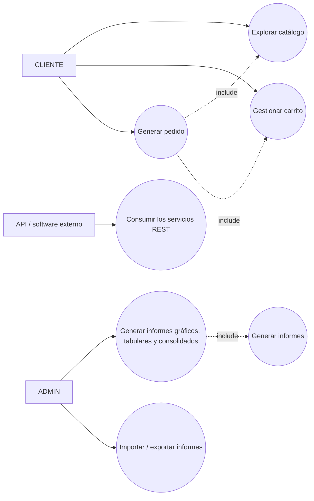
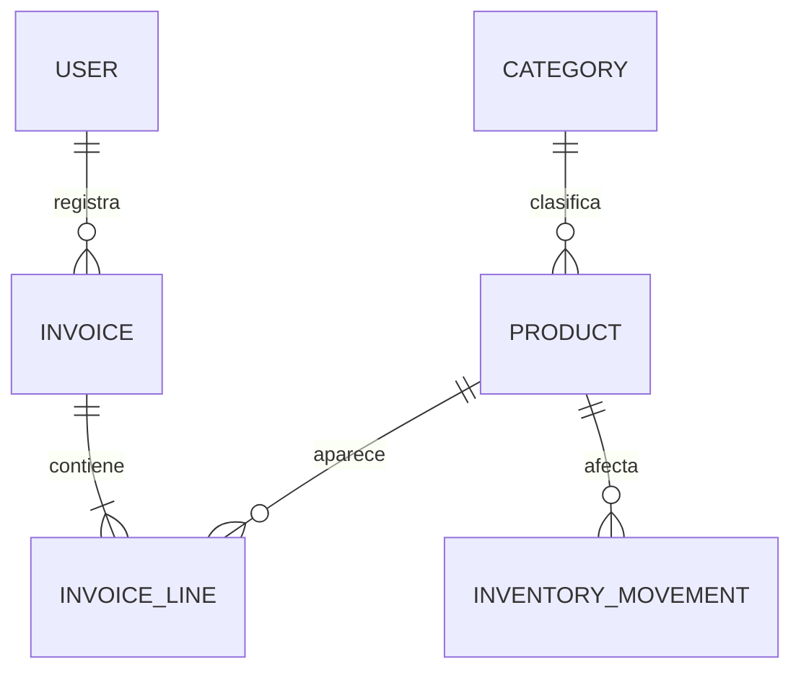
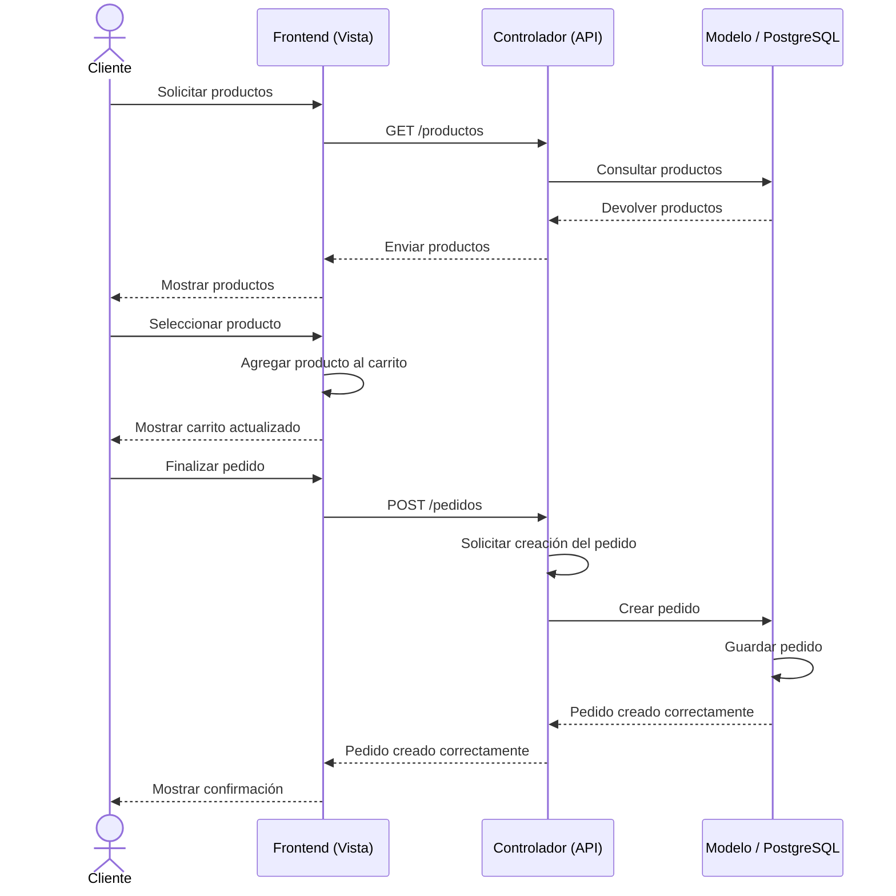

# NexusGear

Aplicación de comercio electrónico de componentes y periféricos gamer, construida a partir
del informe de diseño (casos de uso, diagrama de actividades, vistas de usuario, diagrama
entidad-relación y diagrama de secuencia) de **Ingeniería de Software 2 - UIS**.

- **Autores:** Johan Santiago Rojas Naranjo (2225005), Santiago Alejandro Amaya Díaz (2230085), Daniel Andrés Pinto Ortega (2190558)
- **Profesor:** Urbano Eliécer Gómez Prada

---

## Inicio rápido (colaboradores)

Requisitos: **Node.js 18+** y **PostgreSQL 14+** corriendo (o bien Docker, ver §5.4).

```bash
git clone <URL del repositorio>
cd nexusgear

npm run setup     # crea los .env (si faltan) e instala backend + frontend
psql -U postgres -f database/create-db.sql   # crea el rol y la base (una sola vez)
npm run db:setup  # carga esquema + datos de demostración
npm run dev       # backend :4000 · frontend :5173 (Ctrl+C detiene ambos)
```

Alternativa sin instalar nada más allá de Docker:

```bash
docker compose up --build   # frontend :5173 · backend :4000
```

---

## 1. Arquitectura

Arquitectura **cliente-servidor**. El backend se estructura internamente con el patrón
**Modelo-Vista-Controlador (MVC)**. El Controlador recibe las solicitudes del cliente, el
Modelo opera sobre los datos almacenados en PostgreSQL y la comunicación entre la Vista
(React) y el servidor se realiza mediante una **API REST** que intercambia **JSON**.

```
┌────────────────────┐        HTTP/JSON        ┌──────────────────────────────────────┐
│  Frontend (React)   │  ───────────────────▶   │  Backend (Node.js + Express)          │
│  Vistas de usuario  │   API REST /api/v1      │  ┌────────────┐   ┌─────────────────┐  │
│  Carrito, informes  │  ◀───────────────────   │  │Controller  │──▶│ Model (SQL)     │  │
└────────────────────┘        JSON              │  └────────────┘   └────────┬────────┘  │
        ▲                                        │        ▲                  │           │
        │ consumo externo                        │        │                  ▼           │
┌────────────────────┐                          │  ┌─────┴───────┐   ┌─────────────────┐  │
│  Software externo   │  ── x-api-key / JWT ──▶  │  │ API externa │   │  PostgreSQL      │  │
│  (ERP, tienda, etc.)│  ◀── REST + JSON ─────   │  │ (saliente)  │   └─────────────────┘  │
└────────────────────┘                          └──┴─────────────┴────────────────────────┘
```

### Interoperabilidad (requisito explícito)

- **Cualquier software puede consumir esta API:** contrato **OpenAPI 3.0** en `/api/openapi.json`
  y Swagger UI en `/api/docs`, API **versionada** (`/api/v1`), respuestas JSON uniformes y **CORS**.
- **Autenticación:** JWT (`Authorization: Bearer <token>`) para usuarios o **API key**
  server-to-server (`x-api-key`) para integraciones.
- **El software puede consumir otras APIs:** capa de integración saliente
  (`src/services/externalApi.service.js`) con `axios`, configurable por variables de entorno y
  expuesta vía `/api/v1/integrations/call` (proxy controlado) y `/api/v1/integrations/status`.
- **Informes mezclados con otra software:** el endpoint `/api/v1/reports/combined` consulta la
  API externa (otro software de ventas, configurado con `EXTERNAL_API_BASE_URL` +
  `EXTERNAL_REPORTS_PATH`), normaliza sus filas al mismo formato y las **une** con nuestras ventas.
  Cada fila lleva `source` (`local` | `external`). Si la API externa no responde, el informe
  devuelve solo los datos propios sin romper la vista.

## 2. Tecnologías

| Componente | Tecnología |
| --- | --- |
| Frontend / Vista | React |
| Backend / Servidor | Node.js |
| Framework para API REST | Express.js |
| Base de datos | PostgreSQL |
| Comunicación | API REST |
| Formato de intercambio | JSON |

Otras librerías: `jsonwebtoken`, `bcryptjs`, `helmet`, `cors`, `express-rate-limit`,
`swagger-ui-express`, `recharts` (gráficas), `react-router-dom`.

## 3. Diagramas (implementados)

### 3.1 Casos de uso



### 3.2 Entidad-relación



### 3.3 Secuencia — «Realizar pedido»



## 4. Estructura del proyecto

```
nexusgear/
├─ package.json               # scripts raíz: setup / db:setup / dev / build
├─ scripts/
│  ├─ setup.js                # crea .env desde .env.example e instala dependencias
│  └─ dev.js                  # arranca backend y frontend juntos con prefijos de color
├─ docker-compose.yml         # db + backend + frontend
├─ backend/                 # API REST (MVC)
│  ├─ src/
│  │  ├─ config/            # env, db (pg), swagger (OpenAPI)
│  │  ├─ models/            # acceso a datos (SQL)
│  │  ├─ services/          # lógica de negocio (pedidos, informes, integración)
│  │  ├─ controllers/       # manejo de requests (C)
│  │  ├─ routes/            # rutas /api/v1
│  │  ├─ middlewares/       # auth, api-key, validación, errores, rate-limit
│  │  ├─ utils/             # ApiError, csv, asyncHandler
│  │  ├─ app.js
│  │  └─ server.js
│  ├─ Dockerfile
│  └─ scripts/setup-db.js
├─ frontend/                # React (Vista)
│  ├─ Dockerfile + nginx.conf
│  └─ src/
│     ├─ api/               # cliente axios
│     ├─ context/           # Auth + Carrito
│     ├─ components/        # Navbar, ProductCard, ...
│     ├─ pages/             # Home, Catálogo, Carrito, Pedidos, Reporte, Admin
│     └─ styles/
└─ database/
   ├─ create-db.sql         # crea rol + base (ejecutar como superusuario)
   ├─ schema.sql            # DDL (entidades del diagrama E-R)
   └─ seed.sql              # datos de demostración (catálogo + ventas)
```

## 5. Puesta en marcha

### Requisitos

- Node.js 18+ (probado en Node 22/24)
- PostgreSQL 14+ (probado en PostgreSQL 18)

> **Atajo:** en la raíz, `npm run setup` crea los `.env` (desde los `.env.example`) e instala
> las dependencias de `backend/` y `frontend/`. Después: `psql -f database/create-db.sql`,
> `npm run db:setup` y `npm run dev`.

### 5.1 Crear la base de datos

Con PostgreSQL en ejecución, cree el rol y la base (una sola vez) como superusuario:

```bash
psql -U postgres -f database/create-db.sql
```

Cargue el esquema y los datos de demostración:

```bash
cd backend
cp .env.example .env          # ajuste DATABASE_URL / JWT_SECRET si es necesario
npm install
npm run db:setup
```

> La contraseña por defecto del rol de aplicación es `nexusgear`. Cámbiela en producción.

### 5.2 Backend

```bash
cd backend
npm run dev        # http://localhost:4000   (docs en /api/docs)
```

### 5.3 Frontend

```bash
cd frontend
cp .env.example .env
npm install
npm run dev        # http://localhost:5173
```

### 5.4 Docker (opcional)

```bash
docker compose up --build
# frontend http://localhost:5173 · backend http://localhost:4000
```

## 6. Credenciales de demostración

| Rol | Correo | Contraseña |
| --- | --- | --- |
| Administrador | `admin@nexusgear.com` | `Admin1234!` |
| Cliente | `cliente@nexusgear.com` | `Cliente1234!` |
| Cliente | `johan.rojas@nexusgear.com` | `123456` |
| Cliente (demo) | `mateo.herrera@nexusgear.com` | `Cliente1234!` |

Todos los demás clientes de demostración (Sofía Ramírez, Lucas Fernández, Isabella Moreno,
Tomás Vargas, Ana Martínez, Diego Ruiz, Santiago Amaya, Laura Restrepo, Andrés Torres,
Valentina Cruz, Carlos Gómez) usan `Cliente1234!`. Cada uno tiene sus propias compras: lo que
el informe de administración muestra para una cuenta es exactamente lo que esa cuenta ve en
**Reporte** (`/reporte`) al iniciar sesión.

## 7. API REST (v1)

Base: `/api/v1` · Documentación interactiva: `/api/docs` · OpenAPI: `/api/openapi.json`

| Método | Endpoint | Rol | Descripción |
| --- | --- | --- | --- |
| POST | `/auth/register` | público | Registro de cliente |
| POST | `/auth/login` | público | Inicio de sesión (JWT) |
| GET | `/auth/me` | autenticado | Principal actual |
| GET | `/products` | público | Listar/filtrar productos |
| GET | `/products/:id` | público | Detalle de producto |
| POST/PUT/DELETE | `/products/:id` | admin | Gestión de productos |
| GET | `/categories` | público | Listar categorías |
| POST/PUT/DELETE | `/categories` | admin | Gestión de categorías |
| POST | `/orders` | autenticado | **Crear pedido** (POST /pedidos del diagrama) |
| GET | `/orders` | autenticado | Listar pedidos (propios / todos si admin) |
| GET | `/orders/:id` | autenticado | Detalle de pedido |
| GET | `/inventory` | admin | Movimientos de inventario |
| GET | `/inventory/:productId/movements` | admin | Movimientos de un producto |
| POST | `/inventory/:productId/adjust` | admin | Ajustar stock |
| GET | `/reports/sales` | admin | Informe tabular de ventas |
| GET | `/reports/sales/series` | admin | Serie para gráfica (`groupBy=day\|month`) |
| GET | `/reports/sales/summary` | admin | Resumen consolidado |
| GET | `/reports/sales/consolidated` | admin | Tabular + serie + resumen |
| GET | `/reports/mine` | autenticado | **Informe personal**: transacciones del propio usuario |
| GET | `/reports/combined` | admin | Ventas propias **+ API externa** mezcladas (`groupBy=day\|month`) |
| GET | `/reports/export` | admin | Exportar (`format=csv\|json`, `dataset=sales\|inventory`) |
| POST | `/reports/import` | admin | Importar movimientos de inventario (CSV/JSON) |
| GET | `/integrations/status` | admin | Estado de la API externa saliente |
| POST | `/integrations/call` | admin | Consumir/proxy de una API de terceros |

Ejemplo — crear un pedido (flujo del diagrama de secuencia):

```bash
curl -X POST http://localhost:4000/api/v1/orders \
  -H "Authorization: Bearer <JWT>" -H "Content-Type: application/json" \
  -d '{"items":[{"productId":1,"quantity":1},{"productId":2,"quantity":1}]}'
```

Ejemplo — consumo externo con API key:

```bash
curl http://localhost:4000/api/v1/products -H "x-api-key: change-me-external"
```

## 8. Reglas de negocio destacadas

- Crear un pedido genera una **factura** con sus **líneas**, descuenta **stock** y registra
  un **movimiento de inventario** (`salida`) de forma **transaccional**.
- No se permite vender más unidades que el stock disponible (`409 Conflict`).
- El impuesto es configurable con `TAX_RATE` (por defecto `0`, por lo que los totales coinciden
  con los precios mostrados en las vistas de usuario).

## 9. Licencia

MIT — uso académico.
